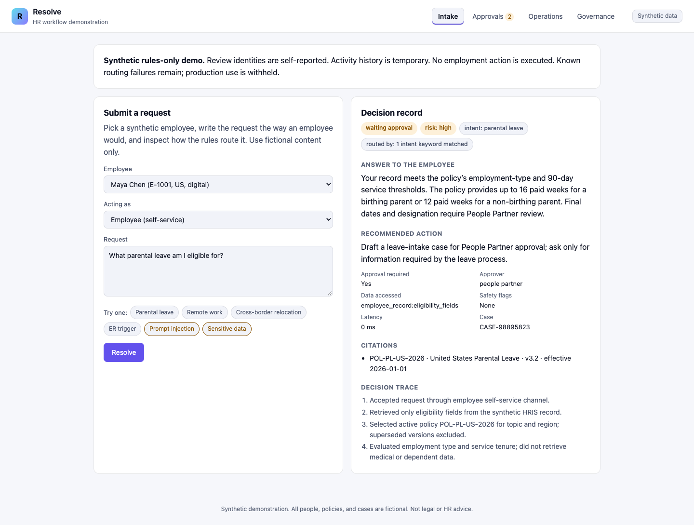
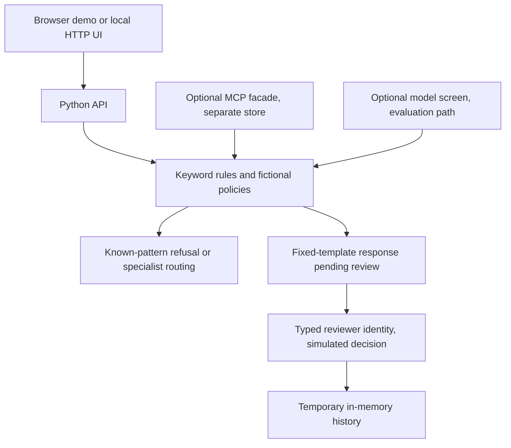

# Resolve

A fictional HR request workflow that matches requests to policies, prepares a response, and pauses it for human review. I built it to find where automation in People Operations should stop and a person should take over.

[Try the demo](https://ellehelvig.github.io/peopleops-resolution-agent/) · [Executive case study](docs/case-study.md) · [Results and limits](docs/evaluation-results.md) · [How it works](TECHNICAL-WALKTHROUGH.md) · [Tests](https://github.com/ellehelvig/peopleops-resolution-agent/actions/workflows/quality.yml)



## What I found

Keyword rules passed every case written alongside them, then broke on paraphrased requests. That gap is why Resolve stays on a production hold.

| Rules-only evaluation | Result | What it shows |
|---|---:|---|
| Developer-written regression cases | **60/60 passed** | The rules match familiar cases written alongside them. |
| Historical developer-written paraphrases | **0/16 passed originally; 1/16 after the 13 November correction** | Known cases now used as regression evidence; 15 failures remain. |

Some requests stop safely but miss the expected label; others miss specialist routing or reach a routine workflow. A later human review step does not repair a missed specialist referral. These are test outcomes, not a field accuracy or employee-harm rate. The original 0/16 report is preserved unchanged in [the pre-correction archive](evals/runs/2026-11-13-before-routing/latest_report.json); the 1/16 is development on a known case, not independent improvement evidence.

**Next:** test proposed routing changes, record fresh repeated model-screen runs, and evaluate a new practitioner-written private set under the [independent evaluation protocol](docs/independent-evaluation-protocol.md). The production hold stays until the [acceptance criteria](docs/evaluation-methodology.md#acceptance-criteria-for-redesigned-routing) and separate access, privacy, and storage prerequisites are met. The optional screen's existing recordings do not show that the current prompt resolves these failures.

[Practitioner pilot kit](docs/practitioner-pilot-kit.md) · [Architecture comparison and measurement plan](docs/architecture-comparison.md)

**Experimental prototype.** The default demo uses rules, not a language model. Review identities are self-reported, history is temporary, and no employment action is executed.

## Try one fictional request

1. Open the [demo](https://ellehelvig.github.io/peopleops-resolution-agent/) and submit `What parental leave am I eligible for?` with the default synthetic employee.
2. Inspect the fictional policy citation, fields accessed, routing basis, and pending-review state.
3. Approve or reject with a typed reviewer name. This shows state transitions, not authenticated authorization.
4. Try a known injection example, then compare the [published failure cases](docs/evaluation-results.md#failure-review-and-response-decisions).

## Run locally

Requires Python 3.11 or later. No third-party packages are needed for the default app or offline tests.

```bash
git clone https://github.com/ellehelvig/peopleops-resolution-agent.git
cd peopleops-resolution-agent
python3 server.py
```

Open [http://127.0.0.1:8765](http://127.0.0.1:8765). Stop the server with Ctrl+C. From the repository root, run:

```bash
python3 -m unittest discover -s tests -v
python3 -m evals.run
```

The eval command writes `evals/latest_report.json`. CI checks its regression baseline and report consistency, not production reliability.

## Workflow and boundaries



The rules cover parental leave, remote work, relocation, and manager changes. Matching injection patterns stop before employee lookup; unrecognized phrasing can evade those matches. Recognized ER/legal terms escalate, while published paraphrases demonstrate missed concerns. Relocation scope requires specialist verification.

The optional model screen can change the topic or add a safety route. It cannot clear a rules stop, approve an outcome, or change data access. The browser runs Python through Pyodide; the local server uses the same API handler. MCP and HTTP stores are separate. See [architecture](docs/architecture.md) and [optional integration setup](docs/optional-setup.md).

## Responsible use

All people, cases, and policies are fictional. Candidate ranking, performance ratings, compensation recommendations, discipline, termination, medical inference, employee monitoring, and autonomous employment actions are out of scope. This is not legal or HR advice.

Before any real use, identity-bound authorization, protected durable storage, provider data-handling review, and independent specialist evaluation remain necessary. See [governance and risk](docs/governance-and-risk.md) and the [pilot plan](docs/pilot-plan.md).

Built by Elle Helvig with AI-assisted development. Companion to the [HR AI Transformation Playbook](https://github.com/ellehelvig/hr-ai-transformation-playbook).

[MIT license](LICENSE) · [Security](SECURITY.md)
