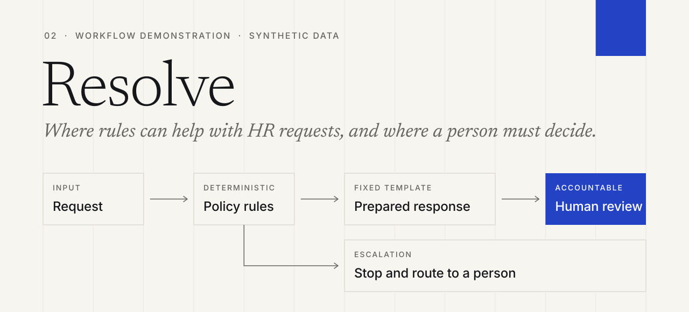

<picture>
  <source media="(max-width: 600px) and (prefers-color-scheme: dark)" srcset="assets/resolve-mobile-dark.svg">
  <source media="(max-width: 600px)" srcset="assets/resolve-mobile-light.svg">
  <source media="(prefers-color-scheme: dark)" srcset="assets/resolve-dark.svg">
  
</picture>

<p align="center">
  <a href="https://ellehelvig.github.io/peopleops-resolution-agent/">Try the demo</a> &nbsp;·&nbsp;
  <a href="TECHNICAL-WALKTHROUGH.md">How it works</a> &nbsp;·&nbsp;
  <a href="docs/evaluation-results.md">Evidence and limits</a>
</p>

<p align="center">
  <a href="https://github.com/ellehelvig/peopleops-resolution-agent/actions/workflows/quality.yml"></a>
  <a href="LICENSE"></a>
  <a href="#run-locally"></a>
  <a href="#current-status"></a>
</p>

<br>

## At a glance

| Aspect | Summary |
|:--|:--|
| **Purpose** | A synthetic demonstration of HR request routing and human review. |
| **Try it** | [Browser demo](https://ellehelvig.github.io/peopleops-resolution-agent/) or [local setup](#run-locally). |
| **Evidence** | [Preserved results and caveats](docs/evaluation-results.md), including failure results. |
| **Status** | Experimental prototype. Production use is withheld. |

<br>

## What it is

Resolve explores where ordinary rules can support HR service work and where a person must remain accountable. It is a synthetic demonstration for People Operations and transformation leaders, with source evidence for technical partners.

A request is matched to one of four supported topics and a fictional policy. A routine request becomes a fixed-template response that waits for a person to approve or reject it. A request with Employee Relations or legal language, or from a region with no matching policy, is escalated to a person. A prompt-injection attempt is refused, with no HR action. An unclear request gets one clarifying question before any employee data is read.

## Why I built this

An HR workflow needs more than a plausible answer. It needs clear data boundaries, policy evidence, a place to stop, and an accountable reviewer. I defined the workflow, controls, and evaluation, then built this prototype with AI-assisted development in Claude Code. The [People Partner work-redesign case study](https://github.com/ellehelvig/hr-ai-transformation-playbook/blob/main/01-use-cases/work-redesign-people-partner.md) explains the choices behind it.

<br>

## Who does what

<picture>
  <source media="(max-width: 600px) and (prefers-color-scheme: dark)" srcset="assets/roles-mobile-dark.svg">
  <source media="(max-width: 600px)" srcset="assets/roles-mobile-light.svg">
  <source media="(prefers-color-scheme: dark)" srcset="assets/roles-dark.svg">
  
</picture>

The browser demo uses deterministic rules and synthetic data. The optional model screen and MCP tool facade are separate from it, and neither establishes authorization or general reliability. Review names are typed, not authenticated. The activity history is temporary and is not protected audit evidence.

<br>

## A one-minute tour

1. Open the [demo](https://ellehelvig.github.io/peopleops-resolution-agent/) and submit `What parental leave am I eligible for?` using the default synthetic employee.
2. Inspect the policy citation, minimum employee fields, routing basis, and pending approval state.
3. Approve or reject the pending recommendation with a typed reviewer name. This demonstrates workflow state, not authenticated authorization.
4. Try the built-in prompt-injection example and inspect the stop before data access.
5. Open Operations and Governance to compare the published evaluation evidence and implementation boundaries.

The rules support parental leave, remote work, relocation, and manager change. Relocation scope requires specialist verification. Names, compensation, medical, demographic, and contact fields are excluded from employee lookup responses.

<br>

## Current status

**Experimental prototype. Production use is withheld.** The repository includes an optional Claude screen that can add routing to a person. It cannot clear a rules stop, approve an outcome, or change data-access controls.

The first model-screen run is early signal from developer-authored cases. It is not independent validation. See the [evaluation evidence](docs/evaluation-results.md) for the preserved results and their limits.

## How far the rules generalize

The original rules passed 60 of 60 regression cases and 0 of 16 developer-authored synthetic paraphrases. Five Employee Relations or legal concerns were not correctly escalated. That historical set has since informed development, so it is now regression evidence.

The first untuned model-screen run reduced harmful misses on developer-authored sets and also produced false refusals of ordinary business requests. Prompt tuning requires new recordings and fresh practitioner-written private evaluation before any release decision. Read the [failure review and response decisions](docs/evaluation-results.md#failure-review-and-response-decisions), [preserved results and caveats](docs/evaluation-results.md) and [acceptance criteria](docs/evaluation-methodology.md#acceptance-criteria-for-redesigned-routing). A passing CI run checks implementation consistency, not production reliability.

[Historical synthetic walkthrough](docs/assets/resolve-walkthrough.gif): this older recording uses approval and activity labels for simulated review and temporary history. It does not demonstrate authenticated approval or protected audit records.

## Before real use

Authenticate employees and reviewers, bind access to identity, use durable approval state and protected storage, approve model-provider data handling, and validate routing against new unseen cases. See [architecture](docs/architecture.md) and [governance and risk](docs/governance-and-risk.md).

Candidate ranking, performance ratings, compensation recommendations, discipline, termination, medical inference, employee monitoring, and autonomous employment actions are out of scope. All demo data is synthetic. This is not legal or HR advice.

<br>

## Technical setup and evidence

<details>
<summary><strong>Local setup, optional integrations, and repository map</strong></summary>

### Run locally

Requires Python 3.11 or later. The default app needs no third-party Python packages:

```bash
git clone https://github.com/ellehelvig/peopleops-resolution-agent.git
cd peopleops-resolution-agent
python3 server.py
```

Open [http://127.0.0.1:8765](http://127.0.0.1:8765) and try the same request as in the tour. The local server and browser demo call the same API handler. The browser version loads Python through Pyodide and keeps request data within the visitor's browser. The local server uses an in-memory store shared by clients of that server.

Run offline checks:

```bash
python3 -m unittest discover -s tests -v
python3 -m evals.run
```

The evaluation command writes `evals/latest_report.json`. That report is committed intentionally and checked for drift in CI.

### Optional MCP and model setup

These features are separate from the default browser demo:

```bash
python3 -m venv .venv
source .venv/bin/activate
python -m pip install --require-hashes --no-deps -r requirements-bootstrap.txt
python -m pip install -r requirements-optional-lock.txt
python mcp_server.py
```

On Windows, activate with `.venv\Scripts\Activate.ps1` in PowerShell. The MCP facade exposes three narrow tools and no approval tool. Its store is separate from the HTTP API's store.

Model-screen evaluation can use signed-in Claude Code or an `ANTHROPIC_API_KEY` stored outside the repo. It consumes plan usage or API credits. Follow [the evaluation methodology](docs/evaluation-methodology.md#recording-a-run-after-the-prompt-injection-boundary-change) before running it, and keep practitioner-written sets private. No live model call is needed for the default app or offline unit tests.

The optional dependency lock records exact versions resolved for Python 3.11 and later. To refresh it, use uv 0.13.4 or later and run `uv pip compile requirements-optional.txt --python-version 3.11 --universal --no-header --upgrade --output-file requirements-optional-lock.txt`, install it in a fresh environment, and rerun the offline checks before review.

The [Python security announcement](https://discuss.python.org/t/109576) requires
pip 26.2.2 or later and certifi 2026.10.19 or later after the October 2026
eMudhra incident. The bootstrap file verifies the official pip wheel by SHA-256.
Repeat the bootstrap and locked install in each existing optional environment,
then restart its processes. Rebuild containers with current system certificates.
The default browser demo does not install these optional SDKs.

### Implementation map

| Path | Purpose |
|---|---|
| `peopleops/` | Rules, policy selection, optional model screening, API routes, and demo state |
| `server.py` | Local HTTP wrapper with request checks, rate limits, and static-file controls |
| `web/` | Browser UI and Pyodide bridge |
| `mcp_server.py` | Optional tool facade with no approval capability |
| `evals/` | Regression and challenge cases, recorded runs, and comparison tools |
| `tests/` | Workflow, privacy, HTTP, MCP, screen, and report-drift checks |
| `docs/` | Architecture, evaluation evidence, risk register, and pilot plan |
| `assets/` | README banner and diagrams, in light, dark, and narrow-screen versions |

</details>

<br>

---

[MIT license](LICENSE) · [Security](SECURITY.md) · [Pilot plan](docs/pilot-plan.md) · [Elle Helvig](https://github.com/ellehelvig) · Companion to the [HR AI Transformation Playbook](https://github.com/ellehelvig/hr-ai-transformation-playbook)
