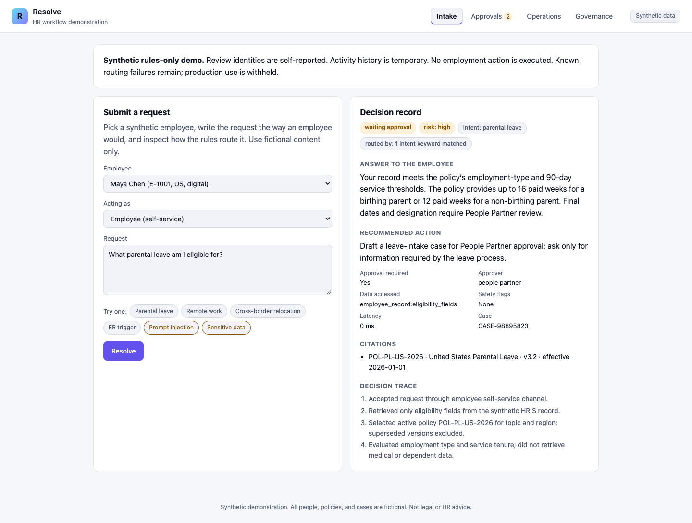
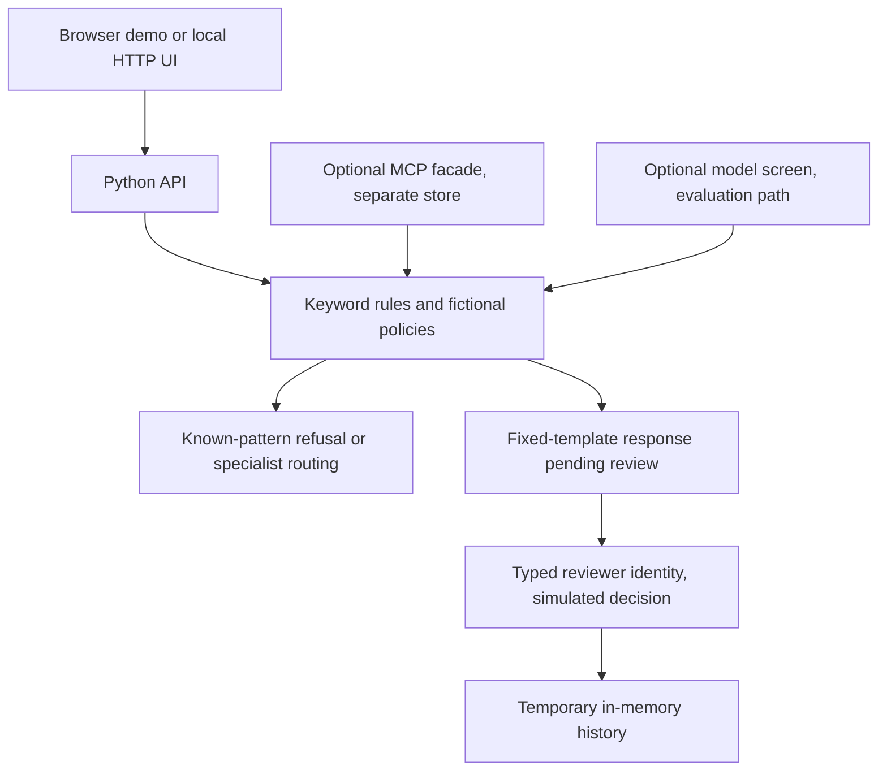

# Resolve

A synthetic HR request workflow for People Operations and HR transformation leaders.
It matches known phrases to fictional policies, prepares fixed-template responses, and pauses recommendations for simulated human review.

[Try the demo](https://ellehelvig.github.io/peopleops-resolution-agent/) · [Results and limits](docs/evaluation-results.md) · [Tests](https://github.com/ellehelvig/peopleops-resolution-agent/actions/workflows/quality.yml) · [How it works](TECHNICAL-WALKTHROUGH.md)

**Experimental prototype. Production use is withheld.** The default demo uses rules, not a language model. Review identities are self-reported, history is temporary, and no employment action is executed.

## Results: passing tests do not mean reliable HR routing

| Rules-only evaluation | Result | What it shows |
|---|---:|---|
| Developer-written regression cases | **60/60 passed** | The rules match familiar cases written alongside them. |
| Developer-written synthetic paraphrases | **0/16 passed** | Different wording exposes routing, refusal, escalation, and intent failures. |

The 0/16 result still reproduces on the current rules-only implementation. Some requests stop safely but miss the expected label; other cases miss specialist routing or reach a routine workflow. These are test outcomes, not a field accuracy or employee-harm rate. A later human review step does not repair a missed specialist referral.

**Next:** test proposed routing changes, record fresh repeated model-screen runs, and evaluate a new practitioner-written private set under the [independent evaluation protocol](docs/independent-evaluation-protocol.md). Keep the production hold until the [acceptance criteria](docs/evaluation-methodology.md#acceptance-criteria-for-redesigned-routing) and separate access, privacy, and storage prerequisites are met. The optional screen's existing recordings do not establish that the current prompt resolves these failures.

## Try one fictional request

1. Open the [demo](https://ellehelvig.github.io/peopleops-resolution-agent/) and submit `What parental leave am I eligible for?` with the default synthetic employee.
2. Inspect the fictional policy citation, fields accessed, routing basis, and pending-review state.
3. Approve or reject with a typed reviewer name. This shows state transitions, not authenticated authorization.
4. Try a known injection example, then compare the [published failure cases](docs/evaluation-results.md#failure-review-and-response-decisions).



## Run locally

Requires Python 3.11 or later. No third-party packages are needed for the default app or offline tests.

```bash
git clone https://github.com/ellehelvig/peopleops-resolution-agent.git
cd peopleops-resolution-agent
python3 server.py
```

Open [http://127.0.0.1:8765](http://127.0.0.1:8765). Stop the server with Ctrl+C. From the repository root, run:

```bash
python3 -m unittest discover -s tests -v
python3 -m evals.run
```

The eval command writes `evals/latest_report.json`. CI checks its regression baseline and report consistency, not production reliability.

## Workflow and boundaries



The rules cover parental leave, remote work, relocation, and manager changes. Matching injection patterns stop before employee lookup; unrecognized phrasing can evade those matches. Recognized ER/legal terms escalate, while published paraphrases demonstrate missed concerns. Relocation scope requires specialist verification.

The optional model screen can change the topic or add a safety route. It cannot clear a rules stop, approve an outcome, or change data access. The browser runs Python through Pyodide; the local server uses the same API handler. MCP and HTTP stores are separate. See [architecture](docs/architecture.md) and [optional integration setup](docs/optional-setup.md).

## Responsible use

All people, cases, and policies are fictional. Candidate ranking, performance ratings, compensation recommendations, discipline, termination, medical inference, employee monitoring, and autonomous employment actions are out of scope. This is not legal or HR advice.

Before any real use, identity-bound authorization, protected durable storage, provider data-handling review, and independent specialist evaluation remain necessary. See [governance and risk](docs/governance-and-risk.md) and the [pilot plan](docs/pilot-plan.md).

Built by Elle Helvig with AI-assisted development. Companion to the [HR AI Transformation Playbook](https://github.com/ellehelvig/hr-ai-transformation-playbook).

[MIT license](LICENSE) · [Security](SECURITY.md)
